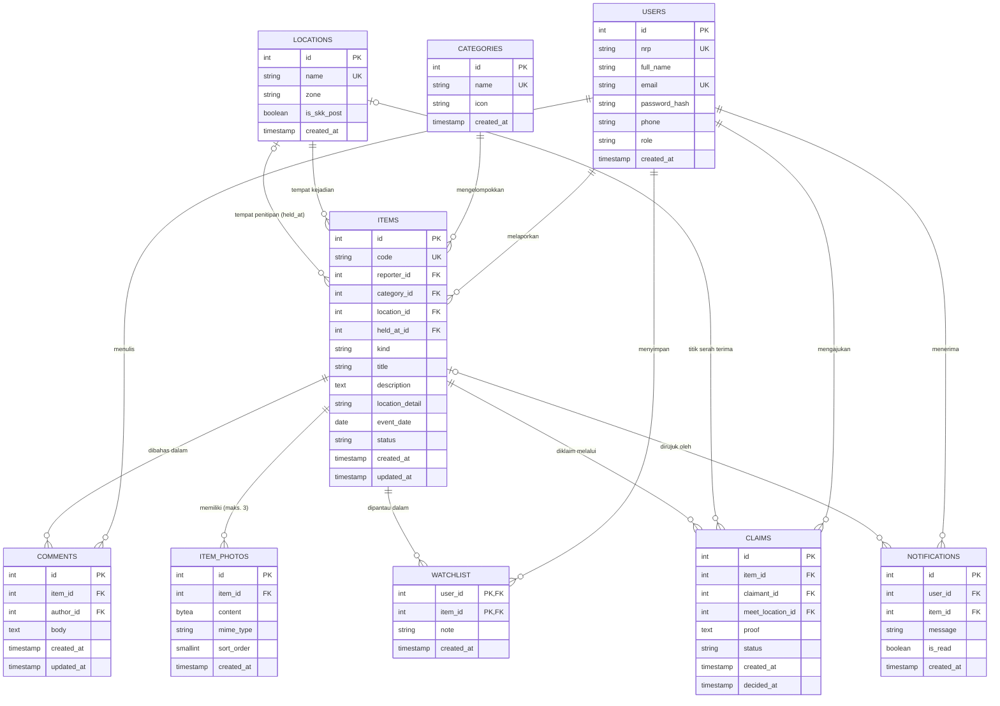

# 1. Model Data Konseptual

Model konseptual Ketemu disusun dari kebutuhan inti layanan barang hilang dan temuan di kampus ITS: mahasiswa melaporkan barang yang hilang atau ditemukan, pihak lain dapat mengklaim barang temuan dengan menyertakan bukti kepemilikan, dan petugas SKK (admin) mengelola data referensi berupa kategori dan lokasi. Diagram berikut menunjukkan sembilan entitas beserta kardinalitas relasinya.

## Penjelasan entitas

| Entitas | Peran dalam sistem |
|---|---|
| **USERS** | Seluruh pengguna terdaftar. Atribut `role` membedakan mahasiswa (`student`) dan petugas meja SKK (`admin`). NRP dan email bersifat unik sehingga satu orang hanya memiliki satu akun. |
| **CATEGORIES** | Data referensi jenis barang (Electronics, Wallets & cards, Keys, dan seterusnya). Setiap kategori memiliki nama ikon yang ditampilkan pada kartu barang. |
| **LOCATIONS** | Data referensi lokasi di kampus. Atribut `is_skk_post` menandai lokasi yang juga berfungsi sebagai pos SKK, yaitu tempat barang temuan dapat dititipkan dan diserahterimakan. |
| **ITEMS** | Laporan barang. Atribut `kind` membedakan laporan barang hilang (`lost`) dan barang temuan (`found`). Atribut `status` mencatat siklus hidup laporan: `open`, `claimed`, `returned`, dan `closed`. Kode tag publik seperti `K-0403` diturunkan dari `id`. |
| **ITEM_PHOTOS** | Foto barang yang disimpan langsung di basis data. Satu laporan memiliki paling banyak tiga foto, dan foto dengan `sort_order` terkecil menjadi foto sampul. |
| **CLAIMS** | Pengajuan klaim atas barang temuan. Klaim memuat bukti kepemilikan (`proof`), titik serah terima yang diusulkan, serta status keputusan dari penemu. |
| **COMMENTS** | Komentar publik pada laporan, misalnya informasi bahwa seseorang pernah melihat barang tersebut di lokasi tertentu. |
| **WATCHLIST** | Entitas asosiatif antara pengguna dan laporan yang ingin dipantau, dilengkapi catatan pribadi maksimal 140 karakter. |
| **NOTIFICATIONS** | Pemberitahuan di dalam aplikasi, misalnya ketika klaim diajukan, disetujui, ditolak, atau ketika barang yang dipantau berubah status. |

## Penjelasan relasi

1. **USERS – ITEMS (1 : N, "melaporkan").** Seorang pengguna dapat membuat nol atau banyak laporan, sedangkan setiap laporan wajib memiliki tepat satu pelapor. Pelapor adalah satu-satunya pengguna (selain admin) yang berhak mengubah, menutup, atau menghapus laporan tersebut.
2. **CATEGORIES – ITEMS (1 : N).** Setiap laporan wajib berada pada tepat satu kategori. Satu kategori dapat dipakai oleh banyak laporan. Kategori yang masih dipakai tidak dapat dihapus.
3. **LOCATIONS – ITEMS (1 : N, dua peran).** Relasi pertama (`location_id`, wajib) menyatakan lokasi barang hilang atau ditemukan. Relasi kedua (`held_at_id`, opsional) menyatakan pos SKK tempat barang temuan dititipkan. Karena satu entitas memiliki dua peran berbeda terhadap entitas yang sama, relasi ini dimodelkan sebagai dua garis terpisah.
4. **ITEMS – ITEM_PHOTOS (1 : N, maksimal 3).** Foto merupakan entitas lemah yang tidak bermakna tanpa laporannya. Batas tiga foto ditegakkan pada lapisan aplikasi (`Uploads.MAX_PER_ITEM`).
5. **USERS – CLAIMS – ITEMS (M : N melalui CLAIMS).** Seorang pengguna dapat mengklaim banyak barang, dan satu barang dapat menerima banyak klaim dari pengguna yang berbeda. CLAIMS tidak sekadar tabel penghubung karena memiliki atribut sendiri (bukti, status, waktu keputusan). Aturan bisnis yang menyertainya: hanya barang temuan berstatus `open` yang dapat diklaim, pelapor tidak dapat mengklaim barangnya sendiri, dan satu pengguna hanya boleh memiliki satu klaim aktif (pending atau approved) untuk barang yang sama.
6. **LOCATIONS – CLAIMS (1 : N, opsional).** Klaim dapat menyebutkan pos SKK yang diusulkan sebagai titik serah terima.
7. **USERS – COMMENTS – ITEMS (M : N melalui COMMENTS).** Banyak pengguna dapat berkomentar pada banyak laporan. Setiap komentar hanya dapat diubah atau dihapus oleh penulisnya, atau oleh admin untuk keperluan moderasi.
8. **USERS – WATCHLIST – ITEMS (M : N melalui WATCHLIST).** Kunci primer gabungan `(user_id, item_id)` menjamin satu laporan hanya tersimpan satu kali pada daftar pantau seorang pengguna.
9. **USERS – NOTIFICATIONS (1 : N) dan ITEMS – NOTIFICATIONS (1 : N, opsional).** Setiap notifikasi ditujukan kepada satu pengguna dan dapat merujuk pada satu laporan agar pengguna dapat langsung membuka laporan terkait.
