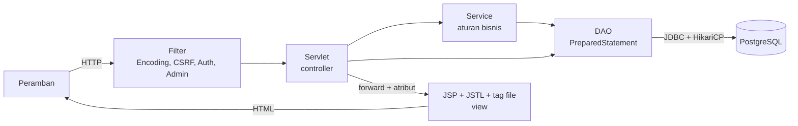

# Bahan Report Ketemu

Folder ini berisi bahan untuk menyusun report Kuis 2 Pemrograman Web. Setiap berkas dapat dipakai langsung sebagai bab atau subbab report. Semua angka, nama kelas, dan hasil uji diambil dari kode dan hasil pengujian proyek ini.

## Daftar isi

| Berkas | Isi | Bagian report yang didukung |
|---|---|---|
| [01-erd-konseptual.md](01-erd-konseptual.md) | Diagram ERD konseptual (Mermaid), penjelasan entitas dan relasi | Database design: conceptual data model |
| [02-model-fisik.md](02-model-fisik.md) | Tabel per tabel (kolom, tipe, batasan, keterangan), indeks, aturan ON DELETE, alasan BYTEA | Database design: physical data model |
| [03-daftar-fitur.md](03-daftar-fitur.md) | 8 fitur CRUD dan fitur pendukung, operasi C/R/U/D beserta rutenya | Feature list |
| [04-screenshot-halaman.md](04-screenshot-halaman.md) | Tangkapan layar setiap halaman dengan penjelasan, termasuk 768 px dan 390 px | Screenshots and explanation per feature |
| [05-pengujian.md](05-pengujian.md) | Tabel 74 kasus uji (termasuk 30 kasus negatif), ringkasan, dan kegagalan selama pengembangan | Analysis and evaluation: functional testing, validation and authorization |
| [06-keamanan.md](06-keamanan.md) | bcrypt, PreparedStatement, CSRF, XSS, session fixation, otorisasi, unggahan, keterbatasan | Analysis and evaluation: security |
| [07-perbandingan-midterm.md](07-perbandingan-midterm.md) | Perbandingan dengan Campus Lost & Found (Laravel), hal yang lebih sulit dan lebih mudah | Analysis and evaluation: comparison with the midterm |
| [08-evaluasi-desain-performa.md](08-evaluasi-desain-performa.md) | Evaluasi desain, responsivitas, aksesibilitas, performa, BYTEA, keterbatasan | Analysis and evaluation: design, performance, limitations |
| [09-pembagian-kerja.md](09-pembagian-kerja.md) | Tabel pembagian kerja (sebagian masih placeholder) | Job descriptions and work distribution |

Pendukung lain di luar folder ini:

- `docs/screenshots/`: 35 berkas PNG tangkapan layar.
- `docs/PANDUAN-DEPLOY.md`: langkah *deploy* ke Render dan Neon (bahan untuk bagian Deployment).
- `tests/smoke-test.js`: skrip pengujian otomatis; `tests/test-results.md` berisi hasil terakhir dalam bahasa Inggris.

## Yang masih perlu diisi

| Isian | Lokasi |
|---|---|
| URL situs *live* dan URL repositori GitHub | Halaman judul report, `README.md` di akar proyek |
| Nama lengkap dan NRP Rayza | `09-pembagian-kerja.md` |
| Peran dan rincian kontribusi setiap anggota | `09-pembagian-kerja.md` |
| Kolom "Hasil live" pada tabel pengujian | `05-pengujian.md` (jalankan ulang skrip uji terhadap situs *live*) |
| Waktu *cold start* dan waktu muat di Render | `08-evaluasi-desain-performa.md` bagian 8.4 |
| Poin bertanda **[verifikasi]** tentang proyek midterm | `07-perbandingan-midterm.md` |

## Ringkasan arsitektur (untuk bagian Tech stack and architecture)

| Lapisan | Teknologi |
|---|---|
| Bahasa dan *runtime* | Java 17, Jakarta EE 10 (Servlet 6.0, JSP 3.1, JSTL 3.0) |
| Server aplikasi | Apache Tomcat 10.1 |
| Basis data | PostgreSQL 16 (lokal di Docker, *production* di Neon) |
| Akses data | JDBC, HikariCP (*connection pool*), PostgreSQL JDBC Driver |
| Keamanan kata sandi | jBCrypt |
| *Build* dan kemasan | Maven (berkas `ROOT.war`), Docker *multi-stage build* |
| *Hosting* | Render (Web Service berbasis Docker) dan Neon (PostgreSQL *serverless*) |
| Pengujian | Playwright (Chromium *headless*) |

Aplikasi mengikuti pola **Model-View-Controller**:



1. Setiap permintaan melewati rantai filter: `EncodingFilter` (UTF-8 dan header keamanan), `CsrfFilter` (token pada `POST`), `AuthFilter` (memuat pengguna dari sesi dan melindungi jalur tertentu), lalu `AdminFilter` (khusus `/admin`).
2. *Servlet* di paket `web` membaca parameter, memvalidasi dengan `Validator`, lalu memanggil *service* atau DAO.
3. *Service* di paket `service` menegakkan aturan bisnis yang melibatkan beberapa tabel (misalnya penyetujuan klaim) di dalam transaksi `Tx`.
4. DAO di paket `dao` menjalankan SQL dengan `PreparedStatement` dan memetakan hasil ke objek model di paket `model`.
5. *Servlet* meneruskan data ke JSP di `WEB-INF/views` (tidak dapat dibuka langsung dari peramban). JSP hanya memakai JSTL, EL, dan *tag file*; *scriptlet* dilarang.
6. Setelah operasi yang mengubah data, *servlet* mengalihkan (*redirect*) ke halaman hasil dengan pesan *flash* (pola Post/Redirect/Get).

Struktur folder:

```
ketemu/
├── Dockerfile, docker-entrypoint.sh, docker-compose.yml, pom.xml
├── docs/            panduan deploy, bahan report, screenshot
├── tests/           skrip pengujian end-to-end dan hasilnya
└── src/main/
    ├── java/id/ketemu/
    │   ├── config/  koneksi basis data, migrasi dan seed saat startup
    │   ├── model/   kelas data (User, Item, Claim, ...)
    │   ├── dao/     akses basis data per tabel, transaksi
    │   ├── service/ aturan bisnis laporan, klaim, notifikasi
    │   ├── filter/  encoding, CSRF, autentikasi, admin
    │   ├── util/    validasi, flash, paginasi, unggahan, format
    │   └── web/     servlet (controller)
    ├── resources/db/  schema.sql, seed.sql
    └── webapp/
        ├── assets/    CSS, JavaScript, ikon
        └── WEB-INF/   web.xml, views (JSP), tags (tag file)
```
